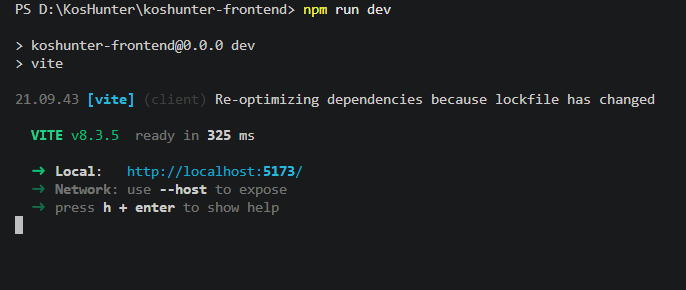
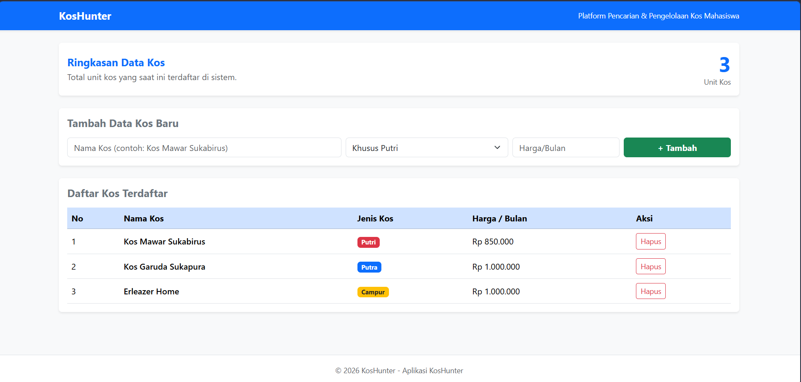
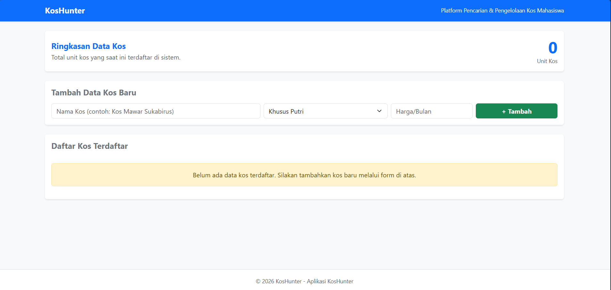

# KosHunter Frontend (React)

Tugas Praktikum Week 6 - React Dasar

**Data Mahasiswa:**
- Nama: Muhammad Lauza Nabil
- NIM: 103022400118

---

## Deskripsi Aplikasi
KosHunter adalah aplikasi web berbasis React JS dan Bootstrap 5 untuk mengelola daftar kosan mahasiswa Telkom University. Dibuat dengan Vite untuk memenuhi tugas praktikum React dasar (penerapan Component, Props, State, Form, dan Conditional Rendering).

---

## Pembagian Komponen React
1. `Navbar.jsx`: Header navigasi aplikasi.
2. `SummaryCard.jsx`: Ringkasan total unit kos yang terdaftar.
3. `KosForm.jsx`: Form input untuk menambah data kos baru.
4. `KosItem.jsx`: Baris data item kos pada tabel.
5. `KosList.jsx`: Tabel daftar kos dengan fitur `.map()` dan Conditional Rendering.

---

## Bukti Tampilan Aplikasi
### 1. Terminal Running (npm run dev)

### 2. Tampilan Utama Aplikasi

### 3. Conditional Rendering (Data Kosong)
