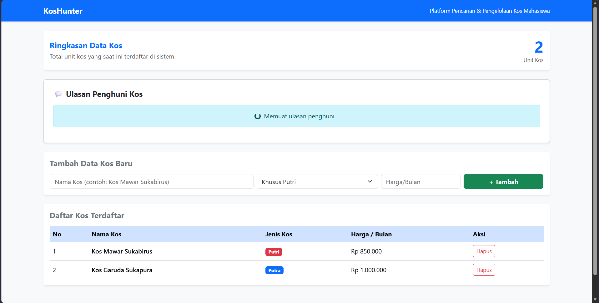
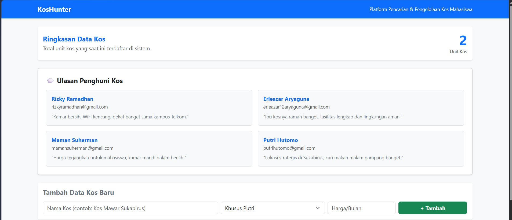
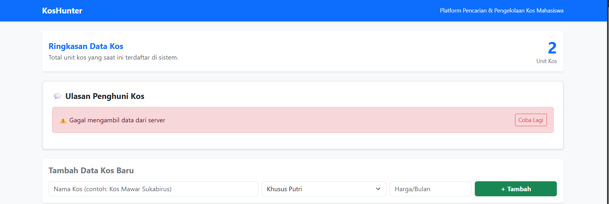

# KosHunter Frontend - Week 7

Tugas Web Week 7 - AJAX dan Konsumsi API Eksternal/Mock

**Data Mahasiswa:**
- Nama: Muhammad Lauza Nabil
- NIM: 103022400118

---

## Deskripsi Penambahan API Eksternal
Aplikasi KosHunter ditingkatkan dengan fitur pengambilan data ulasan/testimoni secara asinkron (AJAX) menggunakan fungsi `fetch()` dari mock API JSONPlaceholder.

## Jawaban Pertanyaan Tugas
1. **Endpoint API yang Digunakan:**
   - URL: `https://jsonplaceholder.typicode.com/comments?_limit=4`
   - **Alasan:** Dipilih sebagai data mock untuk menampilkan ulasan/testimoni pengguna pada halaman katalog KosHunter agar antarmuka terlihat lebih realistis dan dinamis.

2. **Penerapan Pola Loading/Error:**
   - Dikelola pada komponen `TestimonialList.jsx` menggunakan React State (`loading`, `error`, dan `reviews`).
   - Fungsi `fetchReviews()` menangani proses asinkron:
     - Saat proses dimulai, `loading` di-set `true` dan `error` di-set `null`.
     - Jika respons berhasil (`response.ok`), data disimpan ke dalam state `reviews`.
     - Jika proses gagal (`catch`), pesan kesalahan disimpan ke dalam state `error` untuk menampilkan alert merah beserta tombol **"Coba Lagi"** yang memicu pemanggilan ulang fungsi `fetchReviews()`.

---

## Bukti Tampilan Aplikasi

### 1. Kondisi Loading

### 2. Kondisi Success

### 3. Kondisi Error & Tombol Retry

