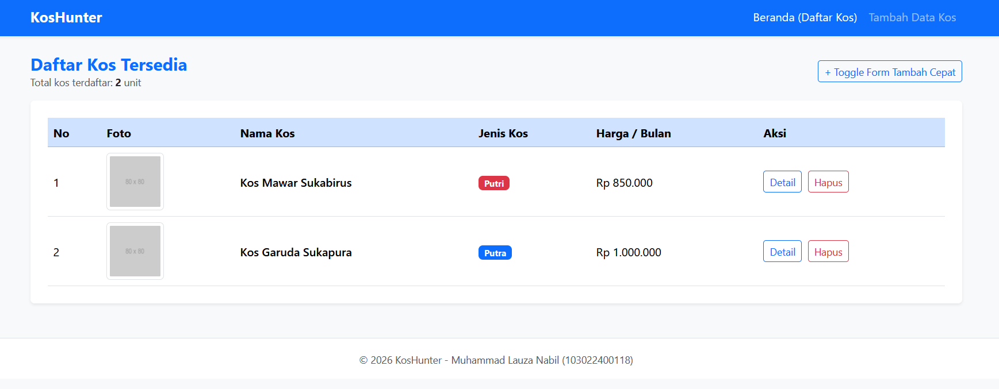
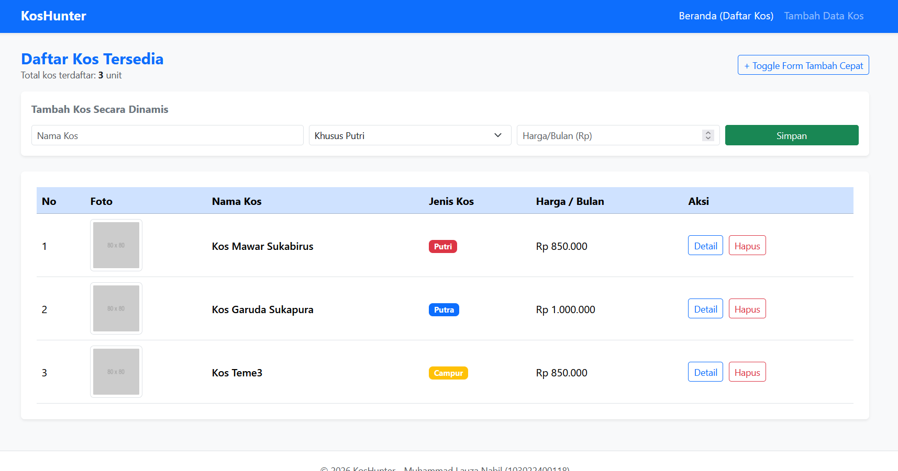

# KosHunter - Platform Informasi Kos Mahasiswa

Tugas Perkuliahan Week 5 - JavaScript & jQuery

**Identitas Mahasiswa:**
- **Nama:** Muhammad Lauza Nabil
- **NIM:** 103022400118

## Deskripsi Singkat
Aplikasi **KosHunter** merupakan platform antarmuka pencarian dan pengelolaan katalog kos mahasiswa di sekitar area kampus Telkom University. Pada BAB 5 ini, aplikasi telah dilengkapi dengan logika JavaScript murni dan library jQuery untuk mendukung interaktivitas sisi *client*.

1. **JavaScript Murni (Vanilla JS):**
   - **Data Dummy (Array of Object):** Menyimpan daftar kos dalam variabel array.
   - **Render Dinamis & Perulangan:** Fungsi `renderTabelKos()` menggunakan perulangan `forEach` untuk membuat baris tabel secara otomatis dari data array.
   - **Kalkulasi Data:** Menghitung jumlah total unit kos yang terdaftar secara otomatis dan menampilkannya pada UI.

2. **jQuery (Interaktivitas & Event Handling):**
   - **Efek Animasi (`slideToggle` & `fadeIn`):** Digunakan untuk menampilkan/menyembunyikan form tambah kos secara cepat serta memunculkan notifikasi sukses.
   - **Event Handling Submit Form:** Menangkap data dari form input untuk ditambahkan ke array data kos secara instan tanpa *reload* halaman.
   - **Event Handling Hapus Data:** Menghapus data kos tertentu dari daftar menggunakan delegasi event klik pada tombol hapus.

### 1. Sebelum Interaksi (Tampilan Awal)

- [Saksikan Video Demo Interaktivitas KosHunter di Sini](https://drive.google.com/drive/folders/1mAskHLw2ZyWq7ibJSLLSY8fRedTLYWuB?usp=sharing)
